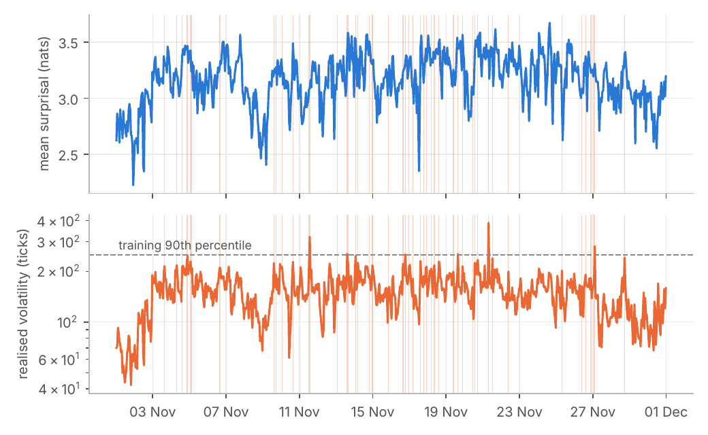
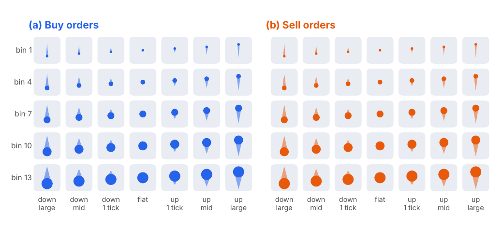
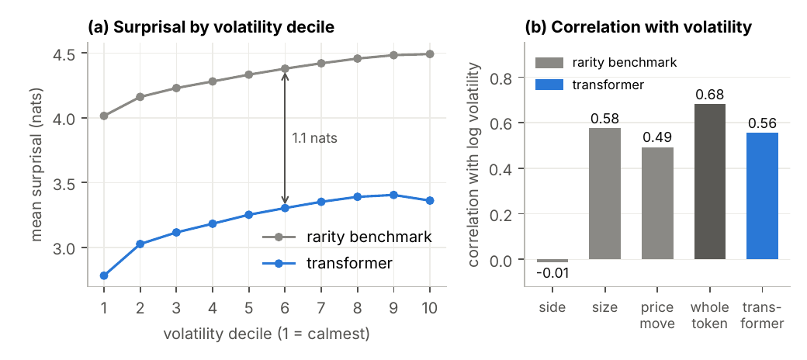
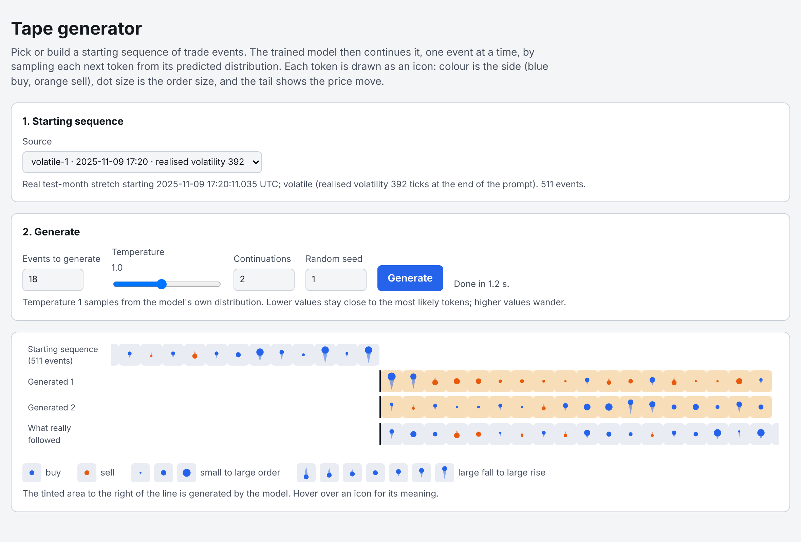

<p align="center"></p>

<h1 align="center">tape-perplexity</h1>
<p align="center"><b>Can a language model of the Bitcoin trade tape tell when the market gets turbulent?</b></p>

<p align="center">
  <a href="paper/main.pdf"></a>
</p>

We turn every Bitcoin trade into a token and train a small causal transformer to predict the next one.
Then we freeze it, point it at an unseen month, and watch how **surprised** it is.

**It is surprised by volatility.** Rolling mean surprisal tracks realised volatility with a correlation of **0.56** over 20 million test events (95% block-bootstrap interval 0.42 to 0.60).

**But less surprised than rarity alone would suggest.** Large price moves are rare tokens, so some of that link is built in. A benchmark that scores each event only by how rare its token is averages 4.33 nats per event. The transformer averages 3.22. It stays about 1.1 nats below the benchmark even in the most volatile tenth of the month.

<p align="center"></p>

*Hourly mean surprisal (top) and realised volatility (bottom) over the test month. Shading marks volatile hours.*

## The idea

- **Tokenise the tape.** One taker order is one event. One event is one token with three fields: side (buy or sell), size (log-spaced bins) and price move (seven classes, from large fall to large rise). The vocabulary is 182 tokens, and there are no timestamps.
- **Train a small GPT.** Six layers, width 192, 2.8M parameters, a 512-event context. One pass over September and October 2025 (31 million events), on a laptop CPU.
- **Score a held-out month.** Every event of November 2025 gets a surprisal, $-\log p(x_t \mid x_{<t})$. We average it over 3,000 events and correlate it with realised volatility over the same events.
- **Detection, not prediction.** The question is whether surprisal is high *when* volatility is high. We make no claim that it leads or predicts.

<p align="center"></p>

*Every token has a picture: colour is the side, dot size is the trade size, and the tail is the price move.*

## Results at a glance

| | Value |
|---|---|
| Correlation of rolling surprisal with log volatility | **0.56** (95% interval 0.42 to 0.60) |
| Mean surprisal, volatile regime vs the rest | 3.35 vs 3.21 nats |
| Mean surprisal, transformer vs token-rarity benchmark | 3.22 vs 4.33 nats |
| Margin below the benchmark, most volatile decile | about 1.1 nats |

<p align="center"></p>

The paper has the full story, including where the built-in part of the link comes from and what the model has and has not learned.
One model, one month and one market: read the limitations before quoting the number.

## Play with it

A local web app continues any stretch of the test month with the trained model and draws the result as comets.
The weights are in `models/`, so it runs straight from a clone.

```bash
pip install -r requirements.txt
python gui.py --open
```

<p align="center"></p>

## Reproduce it

```bash
python run.py --smoke           # tiny version of every stage; a few minutes; checks your setup
python run.py                   # the full study: about 6 hours on a laptop CPU, resumable
pytest                          # unit and end-to-end tests
python paper/make_figures.py    # every figure, number and table in the paper, from the run outputs
make -C paper                   # compile paper/main.pdf (needs LaTeX with latexmk)
```

The full run downloads 91 daily Binance files, trains three seeds, picks the one with the lowest training loss, scores the test month and writes `results/`.
It checkpoints every 10 minutes, prints an ETA every minute, and resumes if interrupted.

## Repository layout

```
run.py            the whole study, one resumable command
gui.py            the generation GUI
tape/             the code: stages/ (download, events, tokenise, volatility, train, score, evaluate, export),
                  model, tokeniser, stats, runtime, and gui/ (the local web app)
tests/            unit tests and end-to-end runs on synthetic data
models/           the trained weights, the fitted tokeniser and the prompt excerpts for the GUI
results/          the study's results: results.json and the evaluation plots
paper/            the paper: TeX source, bibliography, figure script and compiled PDF
docs/             design documents, the design log and the images used in this README
work/             downloaded and tokenised data and training state (created by run.py, not in git)
```

## Docs

- [Paper](paper/main.pdf): the write-up. TeX source, bibliography and figure script are in `paper/`.
- [Project design](docs/project-design.md): the pipeline, the signal, the evaluation, the GUI and the code structure.
- [Tokeniser design](docs/tokeniser-design.md): how raw trades become tokens.
- [Token icons](docs/token-icons.md): the picture for each token.
- [Block bootstrap](docs/block-bootstrap.md): how the confidence interval is computed.
- [Design log](docs/design-log.md): every design decision as it was made.

## License

See [LICENSE](LICENSE).
