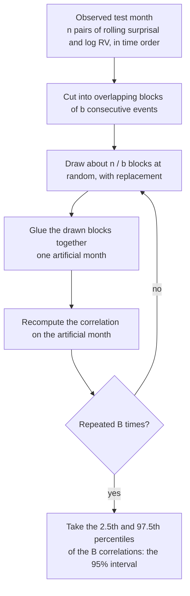

# Block bootstrap for the confidence interval

This note explains how the confidence interval for the headline correlation is computed. It is written to be reused in the write-up. Section 9 holds suggested wording for the paper.

**Status (2026-10-10):** the method is fixed and has been run. The block length is 1,000,000 events (section 7), and the check on the surprisal series (section 7) supports it. The study's interval is 0.42 to 0.60 around a correlation of 0.56. The results are in `results/results.json` and `results/block_length.png`.

---

# Part 1. The idea in plain words

We compute one number from the test month: the correlation between the model's rolling surprisal and the rolling realised volatility. A single number from a single month says nothing about its own reliability. We want an interval around it.

A bootstrap builds that interval by simulation. It makes many artificial test months out of the real one, recomputes the correlation on each, and looks at how much the correlation varies.

How the artificial months are built matters. Our data points are not independent, so we cannot shuffle them one by one. We cut the month into long runs of consecutive events, called **blocks**, and rebuild artificial months by drawing whole blocks at random, with replacement. A block keeps the local structure of the market, and the random draw supplies the variation.

---

# Part 2. The details

## 1. Setting and notation

The scored test month has $n$ events. For event $t$ we have the pair

$$
(x_t,\ y_t) = \big(S_t,\ \log \mathrm{RV}_t\big),
$$

where $S_t$ is the mean surprisal over the last 3000 events and $\mathrm{RV}_t$ is the root mean square of the last 3000 tick moves. The statistic is the sample correlation

$$
\hat\rho=\frac{\sum_{t}(x_t-\bar x)(y_t-\bar y)}{\sqrt{\sum_t (x_t-\bar x)^2\,\sum_t (y_t-\bar y)^2}} .
$$

We want a confidence interval for the true correlation $\rho$. Equivalently, we want the sampling distribution of $\hat\rho$: how much it would change if we could observe another month drawn from the same process.

## 2. The ordinary bootstrap

Draw indices $t_1^*,\dots,t_n^*$ uniformly with replacement from $\{1,\dots,n\}$. Compute $\hat\rho^*$ from the pairs $(x_{t_i^*},y_{t_i^*})$. Repeat $B$ times. The spread of the $\hat\rho^*$ values stands in for the spread of $\hat\rho$.

This works when the pairs are independent. Resampling points one by one then mimics drawing a new sample.

## 3. Why dependence breaks it

For a stationary series $z_t$ with autocovariances $\gamma(h)$, the variance of the mean is

$$
\operatorname{Var}(\bar z)=\frac1n\sum_{|h|<n}\Big(1-\frac{|h|}{n}\Big)\gamma(h)\ \approx\ \frac{\sigma^2_{\mathrm{LR}}}{n},
\qquad
\sigma^2_{\mathrm{LR}}=\sum_{h=-\infty}^{\infty}\gamma(h).
$$

The quantity $\sigma^2_{\mathrm{LR}}$ is the **long-run variance**. For independent data $\sigma^2_{\mathrm{LR}}=\gamma(0)$, and the formula reduces to the familiar $\sigma^2/n$.

Shuffling single points destroys the dependence. The ordinary bootstrap therefore reproduces only $\gamma(0)/n$. When the autocorrelation is positive, $\sigma^2_{\mathrm{LR}}\gg\gamma(0)$, and the resulting interval is far too narrow.

The ratio $\sigma^2_{\mathrm{LR}}/\gamma(0)$ is the **design effect**. The **effective sample size** is $n_{\text{eff}}=n\,\gamma(0)/\sigma^2_{\mathrm{LR}}$, the number of independent points that would carry the same information.

**Our series are an extreme case.** A rolling mean over $M=3000$ events shares all but one event with the next value. Even if the per-event items were independent, the autocorrelation of the rolling mean would fall linearly:

$$
\rho(h)=1-\frac{|h|}{M}\quad(|h|<M),
\qquad
\sum_{h=-\infty}^{\infty}\rho(h)=M .
$$

The design effect is then $M=3000$. The ordinary bootstrap would behave as if there were 3000 times more independent data than there is, and that is before any persistence of volatility regimes is counted.

## 4. The block bootstrap

Fix a block length $b$.

1. **Make blocks.** For each start $j=1,\dots,n-b+1$, define the block
   $\mathcal B_j=\big((x_j,y_j),\dots,(x_{j+b-1},y_{j+b-1})\big)$.
2. **Draw.** Draw $k=\lceil n/b\rceil$ starts $j_1,\dots,j_k$ independently and uniformly.
3. **Glue.** Concatenate $\mathcal B_{j_1},\dots,\mathcal B_{j_k}$ and cut the result to length $n$. This is one artificial month $(x^*_t,y^*_t)$.
4. **Recompute.** Compute $\hat\rho^*$ on the artificial month.
5. **Repeat** steps 2 to 4 $B$ times (for example $B=2000$) to obtain $\hat\rho^*_1,\dots,\hat\rho^*_B$.
6. **Interval.** The 95% percentile interval is $\big[\hat\rho^*_{(0.025)},\ \hat\rho^*_{(0.975)}\big]$, the 2.5th and 97.5th percentiles of the replicates.

Two points about the design:
- The pairs $(x_t,y_t)$ are resampled together. Whatever relation holds between the two series inside a block is preserved.
- Only the glue points between blocks are artificial. Inside a block, the data are exactly as observed.

**A tiny example.** Take $n=12$ and $b=4$, so $k=3$. If the drawn starts are $2,\ 9,\ 5$, the artificial month uses the observed events

$$
\underbrace{2,3,4,5}_{\mathcal B_2},\ \underbrace{9,10,11,12}_{\mathcal B_9},\ \underbrace{5,6,7,8}_{\mathcal B_5}.
$$

## 5. Why it works

Blocks keep the dependence up to lag $b$. Different blocks are drawn independently. The bootstrap variance of a resampled mean is therefore approximately

$$
\operatorname{Var}^*(\bar z^*)\ \approx\ \frac1n\sum_{|h|<b}\hat\gamma(h),
$$

which approaches $\sigma^2_{\mathrm{LR}}/n$ when $b$ is large enough to include all the autocovariance that matters. The correlation $\hat\rho$ is a smooth function of five means, $\bar x,\ \bar y,\ \overline{x^2},\ \overline{y^2},\ \overline{xy}$, so the same reasoning carries over to it.

The standard conditions for consistency are:
- the series is **stationary**, meaning its statistical behaviour does not drift over the period,
- the dependence **fades** with lag (weak dependence), and
- the block length grows with $n$, but more slowly: $b\to\infty$ and $b/n\to0$.

## 6. Computing it cheaply

The test month has about 21 million events, and we need thousands of replicates. Resampling 25 million points each time would be slow. Because $\hat\rho$ depends only on five sums, we can avoid it.

Compute running sums once:

$$
C^{x}_t=\sum_{s\le t}x_s,\quad
C^{y}_t=\sum_{s\le t}y_s,\quad
C^{xx}_t=\sum_{s\le t}x_s^2,\quad
C^{yy}_t=\sum_{s\le t}y_s^2,\quad
C^{xy}_t=\sum_{s\le t}x_sy_s .
$$

The five sums over block $\mathcal B_j$ are then differences, for example $\sum_{s=j}^{j+b-1}x_s=C^{x}_{j+b-1}-C^{x}_{j-1}$. A replicate needs only $k$ such differences added up, and then one evaluation of the correlation formula. Each replicate takes microseconds, however large $n$ is.

## 7. Choosing the block length $b$

**The trade-off.**
- If $b$ is too short, the blocks cut the dependence at lag $b$, and the interval is too narrow.
- If $b$ is too long, there are few blocks ($k=n/b$), and the interval itself becomes noisy.

**The textbook rule** gives $b$ of order $n^{1/3}$ for variance estimation (Hall, Horowitz and Jing, 1995). Politis and White (2004) give an automatic data-driven version. For $n=21$ million, $n^{1/3}\approx275$ events. That is far below the dependence range of our series, which is at least 3000 events from the rolling window alone. So the textbook rule does not apply directly, and the length must come from the data.

**Evidence from the training period.** Without a model yet, I used $\log \mathrm{RV}_t$ as a stand-in for both series, since the surprisal series is also a 3000-event rolling mean. The numbers cover the 61 training days (Sep and Oct 2025), and none of the test month.

Autocorrelation of $\log \mathrm{RV}_t$ at a lag of $h$ events:

| Lag $h$ (events) | 3,000 | 10,000 | 30,000 | 100,000 | 300,000 | 1,000,000 |
|---|---|---|---|---|---|---|
| All 61 days | 0.89 | 0.84 | 0.80 | 0.73 | 0.58 | 0.15 |
| Without 10 Oct | 0.73 | 0.60 | 0.50 | 0.36 | 0.25 | 0.20 |

How the standard error of the mean of $\log \mathrm{RV}_t$, estimated from block means, depends on the block length. The ratio is to the standard error that assumes independence:

| Block length $b$ (events) | Blocks (all days) | Ratio, all days | Ratio, without 10 Oct |
|---|---|---|---|
| 3,000 | 10,324 | 5.4 | 5.2 |
| 10,000 | 3,097 | 9.6 | 8.9 |
| 30,000 | 1,032 | 16.1 | 14.0 |
| 100,000 | 309 | 28.5 | 23.1 |
| 300,000 | 103 | 47.5 | 35.6 |
| 1,000,000 | 30 | 83.0 | 57.9 |
| 3,000,000 | 10 | 98.0 | 90.9 |

**Reading the evidence.** The ratio keeps growing as blocks get longer. There is no plateau up to several million events, and a block of 1,000,000 events is roughly one to two days of trading (about 0.5 million events a day in the training period). Volatility in this data is persistent on the scale of days, so the effective number of independent stretches is small. Short blocks, such as 3000 or 30,000 events, would understate the uncertainty by a large factor.

**Decision: $b=1{,}000{,}000$ events, about 1.5 days of the test month.**
- It reaches 85% of the ratio seen at 3 million events with all days included, and about 64% with 10 October excluded. By 1,000,000 events the autocorrelation has fallen to 0.15 to 0.20.
- It leaves about 21 blocks in the test month, enough for a usable interval.
- Longer blocks would leave too few blocks to resample.

**Result on the test month.** The evaluation stage repeated the check on the series that the statistic is built from. The bootstrap standard error of the correlation rises with block length and levels off near the length used.

| Block length (events) | 1,000 | 10,000 | 100,000 | 300,000 | 1,000,000 | 2,000,000 |
|---|---|---|---|---|---|---|
| Standard error | 0.007 | 0.017 | 0.030 | 0.040 | 0.045 | 0.041 |

**Limits of this check.** The training-period evidence above uses $\log \mathrm{RV}$ as a proxy for both series. The test-month check uses the real series. Choosing the block length from the series being resampled is the usual practice, and the check measures dependence only. It does not use the size of the correlation.

## 8. What the interval does and does not cover

**It covers** the uncertainty that comes from observing one finite month, allowing for dependence within the month.

**It does not cover:**
- Training randomness. The seeds are checked by comparing the three losses, not by this interval.
- Whether the relationship holds in another month or market.
- Non-stationarity beyond what the blocks contain. If November has a level shift that no block reproduces, the interval understates it.

**The effective sample size in regimes is small.** November has a handful of distinct stressed episodes. The interval should be wide. A wide interval is an honest statement, and the write-up should say so.

## 9. Suggested wording for the write-up

> We compute a 95% confidence interval for the correlation using a moving-block bootstrap. Both series are 3000-event rolling means, so consecutive values are almost identical, and volatility is persistent on the scale of days. We therefore resample blocks of 1,000,000 consecutive events (about 1.5 days of the test month), drawing blocks with replacement and recomputing the correlation on the reassembled series. We repeat this 2,000 times and report the 2.5th and 97.5th percentiles. The interval reflects the sampling uncertainty of a single test month. It does not cover training randomness or other periods.

## 10. References

- Künsch, H. R. (1989). The jackknife and the bootstrap for general stationary observations. *Annals of Statistics*, 17(3), 1217–1241. [Project Euclid](https://projecteuclid.org/journals/annals-of-statistics/volume-17/issue-3/The-Jackknife-and-the-Bootstrap-for-General-Stationary-Observations/10.1214/aos/1176347265.full)
- Hall, P., Horowitz, J. L. and Jing, B.-Y. (1995). On blocking rules for the bootstrap with dependent data. *Biometrika*, 82(3), 561–574.
- Politis, D. N. and White, H. (2004). Automatic block-length selection for the dependent bootstrap. *Econometric Reviews*, 23(1), 53–70. [IDEAS](https://ideas.repec.org/a/taf/emetrv/v23y2004i1p53-70.html)
