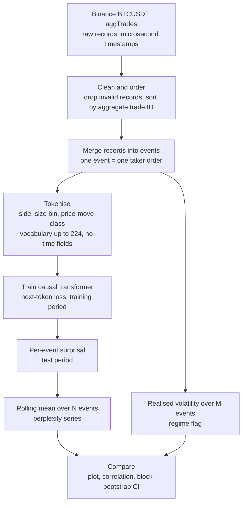

# Tape Perplexity: project design

**Status (2026-10-09):** design stage, no code yet. The tokeniser is fully specified in [tokeniser-design.md](tokeniser-design.md). The two window lengths, the regime threshold and the model settings are still open (see [section 9](#9-open-decisions)).

Part 1 is a short overview. Part 2 holds the detailed design notes.

---

# Part 1. Overview

## The question

Can a small language-model-style network tell, from the raw sequence of trades alone, that the market has entered a volatile regime?

The test is whether the network's *perplexity* (how surprised it is by the next trade) rises and falls with realised volatility.

## The idea in four steps

1. **Turn each trade event into a token.** A token records who was aggressive (buyer or seller), how big the trade was, and how far the price moved. Time is deliberately left out.
2. **Train a small causal transformer** to predict the next token, as a language model predicts the next word. Training uses the earlier part of the study period.
3. **Measure surprise.** For every event, take the model's surprisal, $-\log p(\text{token}\mid\text{past})$. Average it over a rolling window to get a perplexity series.
4. **Compare with volatility.** On the later test period, check whether the perplexity series moves together with realised volatility.

## Pipeline at a glance

## What this project is not

- It is **not a price predictor.** The model is only asked how surprised it is.
- It is **not (yet) an early-warning test.** The claim is *detection*: perplexity tracks the regime. Whether perplexity *leads* volatility is deferred. It will be examined only if the first result is strong.
- It is **not a trading strategy.** It makes no claim about profit.

## Why it might work, and why it might not

- *Might work:* in a calm market the sequence of sizes and price moves is regular, so the model predicts it well. In a stressed market the pattern changes, so the model should be more surprised.
- *Might not:* large price moves are themselves tokens, so some link between perplexity and volatility is expected almost by construction. This is accepted. The model is meant to learn the regime from the data. The question is how strong and stable the relationship is on the held-out test period.

---

# Part 2. Design notes

## 1. Goal and claim

- Use the model's "confusion" as a regime or volatility detector.
- The claim under test: on a held-out test period, rolling perplexity correlates with realised volatility.
- An early-warning test (does perplexity rise *before* volatility?) is out of scope for the first result.

## 2. Scope discipline

The final write-up has to be readable by a human. Every extra test, caveat or variant costs the reader attention. So extras are left out unless they change a conclusion.

Left out by default:

| Item | Why it is out |
|---|---|
| Early-warning (lead) tests | A forecasting claim, deferred until detection is shown |
| GARCH or trade-intensity baselines | A second model to explain |
| Order book data | Extra data and complexity; not needed for the claim |
| Multiple architectures or token schemes | A grid of results to explain |

## 3. Data

- **Source:** Binance spot, symbol BTCUSDT, aggregated trades ("aggTrades"). Daily and monthly files are published at data.binance.vision. The CSV files have no header row. The columns are `a, p, q, f, l, T, m, M` (in that order), with `m` and `M` written as `True` or `False`.
- **Why crypto:** the non-crypto sources with trade-level data cost money. BTC is the single instrument.
- **Period:** 1 September to 30 November 2025 (UTC), 91 days. Timestamps in files from 2025 on are in **microseconds**.
- **Split:** chronological. Training is September and October (61 days). Testing is November (30 days).
- **Why this period:** September 2025 is the calmest month since January 2025. The training months include the 10 October liquidation crash. November has several separate stressed stretches, so the test result does not rest on a single day. In a daily-volatility screen, 14 of the 30 test days were above the training 90th percentile.
- **Size:** the monthly files total about 1.5 GB compressed. The training period has 31 million events (measured). November is estimated at about 25 million, so the whole period holds about 55 million events. Process the files month by month.
- **Cleaning:** drop records with price 0 or quantity 0. Binance uses these to flag duplicates found in a data audit. Order the remaining records by aggregate trade ID.
- **Raw record fields** (names as in the Binance API):

| Field | Meaning |
|---|---|
| `a` | aggregate trade ID (ordering key) |
| `p` | price (USDT) |
| `q` | quantity (BTC) |
| `f`, `l` | first and last individual trade ID in the aggregate |
| `T` | timestamp (microseconds in recent data files) |
| `m` | buyer was the maker. If true, the aggressor was a **seller**. If false, a **buyer**. |
| `M` | best price match flag (not used) |

- **Instrument constants** (from Binance `exchangeInfo`): tick size 0.01 USDT; lot step and minimum quantity 0.00001 BTC; minimum notional 5 USDT.

## 4. Tokeniser

Specified in full in [tokeniser-design.md](tokeniser-design.md). In brief:

- One token per **event**, where an event is one taker order rebuilt from consecutive aggTrade records.
- A token has three fields: **side** (2 values), **size** (log-spaced bins, at most 16), **price move** (7 classes, measured in ticks).
- The three fields form one composite token ID. The vocabulary is at most $2\times16\times7=224$, with a single softmax.
- No time fields. Anything fitted uses the training period only.

## 5. Model

- A small causal (decoder-only) transformer, trained with next-token cross-entropy on the training period.
- Model size, context length and optimiser settings are not yet decided. They should be small enough for a laptop-scale budget.
- The vocabulary is small, so the output layer is cheap.

## 6. The perplexity signal

For event $t$ with token $x_t$ and past tokens $x_{\lt t}$, the **surprisal** is

$$
s_t = -\log p_\theta(x_t \mid x_{\lt t}).
$$

The **rolling mean surprisal** over the last $N$ events is

$$
S_t = \frac{1}{N}\sum_{i=0}^{N-1} s_{t-i}.
$$

The **perplexity** is $\exp(S_t)$. The exponential is monotonic, so plots and correlations can use $S_t$ directly.

The window is $N=M=3000$ events. Both series then summarise exactly the same events, both are trailing windows ending at the same event, and there is no separate parameter to tune. If the surprisal series later proves much noisier than $\mathrm{RV}$, $N$ could be revisited using training data only.

## 7. The regime (volatility) signal

- Volatility is **realised volatility over the last $M=3000$ events**. Windows are in *event time*, not clock time. This matches the token stream, which also has no clock.
- The estimator is the **root mean square (RMS) of the per-event price moves**, in ticks:

$$
\mathrm{RV}_t=\sqrt{\frac1M\sum_{i=0}^{M-1}\Delta_{t-i}^2},
$$

  where $\Delta_t$ is the price move of event $t$ (see the tokeniser design). The squared moves average to an estimate of the variance of a price move. Large sweeps count as high volatility, which is intended for a crash regime.
- Bid-ask bounce adds a roughly constant offset to $\mathrm{RV}_t$, and heavy-tailed moves make it noisy. Both are accepted as properties of the setup.
- A **high-volatility regime** is a period when $\mathrm{RV}_t$ exceeds a threshold. The threshold is the **90th percentile of $\mathrm{RV}_t$ over all events in the training period**. The test period is judged against this fixed training threshold. The flag is used to shade regimes in the plots. The headline correlation does not depend on it.
- In a check on the 61 training days, the threshold came to about 251 ticks. Four properties are worth knowing:
  - The crash of 10 October supplies 45% of all flagged events. Excluding it would lower the threshold to about 222 ticks. It is kept, because the crash is part of the training data.
  - Flagged events are 10% of events but only about 2% of clock time, because trading is much busier in stressed periods.
  - The volatility level shifts between months. The September threshold (159 ticks) would flag 50% of October events. So the share of flagged events in the test month need not be 10%.
  - Most flagged episodes are short. 82% last under one window (3000 events), but they hold only 16% of flagged events. The 33 episodes of 10,000 events or more hold 56%.
- **Why $M=3000$.** It was chosen on 23 training days (none from the test month).
  - Below about 1000, one large sweep supplies a large share of a window's variance.
  - At 3000, the largest single event contributes about 5 to 8% of a window.
  - A window spans about 12 minutes on a calm day and about 30 seconds at the peak of the 10 October crash.
  - Adjacent non-overlapping windows agree with a correlation of about 0.6 in $\log\mathrm{RV}$ on ordinary days (median 0.61 over the 23 days).
  - Beyond 3000 the gains are small and calm-day windows start to exceed 40 minutes.

## 8. Evaluation

- Plot the perplexity series against realised volatility over the test period.
- Report the correlation between them on the test period.
- Give a **block-bootstrap confidence interval**, because consecutive events are strongly dependent. The block length is open.
- No other statistics are planned (see section 2).

## 9. Open decisions

| Decision | Notes |
|---|---|
| Model size and training settings | Not yet discussed |
| Bootstrap block length | Not yet discussed |

## 10. Design rationale

- **Why tokens are trade events.** A token describes who was aggressive, how large the trade was and how far the price moved. This is richer than a price or return level.
- **Why no time fields.** The model is not told how long passed between events. Its only evidence about the regime is the content of the trade sequence.
- **Why the model may use volatility information in the tokens.** The test asks whether the model can recognise a volatile regime. The only thing it can use is the data, so using it is the point of the test.
- **Why event time.** The token stream has no clock. Measuring the windows in events keeps the signal and the target on the same footing.
- **Why a chronological split.** A random split would leak future information into training.

## 11. Glossary

| Term | Meaning |
|---|---|
| aggTrade | Binance's aggregated trade record: fills of one taker order at one price and time, summed |
| aggressor / taker | The side that crossed the spread and removed liquidity |
| event | One taker order, rebuilt by merging consecutive aggTrade records |
| tick | Smallest price step, 0.01 USDT |
| surprisal | The negative log of the probability the model gave to the observed token |
| perplexity | The exponential of the mean surprisal over a window |
| regime | A stretch of high or low realised volatility |
| event time | Windows measured in numbers of events, not seconds |

## 12. Working agreements for this repo

- Commit locally after any substantive change. The owner pushes to the remote.
- Design decisions are logged in [design-log.md](design-log.md) as they are made.
- Facts that can be looked up (exchange constants, API semantics) are verified online, not assumed.
