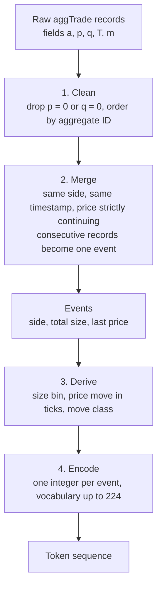

# Tokeniser design

**Status (2026-10-09):** fully specified, not yet implemented. A few implementation details are left open in [section 9](#9-implementation-details-left-open).

This tokeniser feeds the model described in [project-design.md](project-design.md).

---

# Part 1. Overview

## What the tokeniser does

It turns the raw Binance BTCUSDT trade feed into a sequence of integer tokens. **One token describes one taker order**, which this document calls an *event*. The token says three things:

1. **Side:** did a buyer or a seller take liquidity?
2. **Size:** how many BTC were traded, on a log scale.
3. **Price move:** how far did the price move, in ticks, relative to the previous event?

There are no time fields. The token stream has no clock.

## Pipeline

## The token at a glance

| Field | Values | Meaning |
|---|---|---|
| Side | 2 | Buy aggressor or sell aggressor |
| Size bin | up to 16 | Log-spaced edges, 3 per decade, rare tails merged |
| Move class | 7 | Flat, up 1 tick, up mid, up large, down 1 tick, down mid, down large |

The vocabulary is at most $2\times16\times7=224$ tokens, with one softmax over all of them.

## Worked example (illustrative numbers)

The previous event ended with a last fill at **82,000.10**. Four raw records arrive next:

| `a` | `p` | `q` (BTC) | `T` | aggressor | what happens |
|---|---|---|---|---|---|
| 5001 | 82,000.10 | 0.0020 | t1 | buy | starts an event |
| 5002 | 82,000.11 | 0.0150 | t1 | buy | same side, same time, price up: **merge** |
| 5003 | 82,000.13 | 0.0400 | t1 | buy | same side, same time, price up: **merge** |
| 5004 | 82,000.12 | 0.0010 | t2 | sell | different side and time: new event |

Event 1 (records 5001 to 5003):

- **Side:** buy.
- **Size:** $0.0020+0.0150+0.0400=0.0570$ BTC. This falls in the size bin from 0.05 to 0.108 BTC.
- **Price move:** the last fill is 82,000.13 and the previous event's last fill was 82,000.10. The difference is 0.03 USDT, which is **+3 ticks**. A move of 2 or more ticks is "mid" or "large", depending on the training median of such moves. That median was about 104 ticks in a live sample, so this move is "up mid".

That is one token. Record 5004 starts a separate sell event.

---

# Part 2. Design notes

## 1. Why one token per event

Binance's aggTrade record sums the fills of one taker order that occur at the same price and time. An order that sweeps several price levels therefore appears as several records. Treating each record as a token would turn one decision into several strongly dependent tokens.

So records are merged back into events. In a live sample of 388,987 records, 58.4% of records sat in multi-record events. The sample collapsed to 199,944 events, about 1.95 records per event. Merging is not a marginal clean-up.

## 2. Cleaning

- Drop records with price 0 or quantity 0. Binance flags audit duplicates this way. They also carry first and last trade ID of -1.
- Order the remaining records by aggregate trade ID (`a`).

## 3. Merge rule

Walk the cleaned records in order. A record joins the current event when all three tests pass:

1. **Same side.** The aggressor is a seller if `m` is true (the buyer was the maker). Otherwise it is a buyer.
2. **Same timestamp.** `T` is equal at the data's native resolution, which is microseconds in recent files.
3. **Price strictly continues in the aggressor's direction.** For a buy, the price is higher than the previous record's price. For a sell, it is lower.

Otherwise the record starts a new event.

An event has three properties:

- `side`: the common side.
- `size`: the sum of the record quantities, rounded to the lot step of 0.00001 BTC.
- `last_price`: the price of the last record in the event.

Notes on this rule:

- Requiring contiguous trade IDs was considered and dropped. The test was vacuous: in the sample, 100.000% of adjacent record pairs were contiguous.
- Test 3 rarely binds at microsecond resolution. The sample had 190,101 pairs with the same side and the same microsecond. Only 1,058 failed test 3 (1,051 at the same price and 7 against the aggressor's direction). It stays as a cheap guard, and would bind more often with millisecond timestamps.

## 4. Field 1: side

Buy aggressor or sell aggressor, taken from `m` as above. An event takes the side of its records.

## 5. Field 2: size

### Unit

Size is measured in **BTC**, the native unit of the data and of order book depth. Both BTC and USDT notional drift over time as the price moves, so neither unit is stationary.

### Bins: log-spaced edges

Size bin edges are fixed constants on a log scale, 3 bins per decade:

$$
e_k = 5\times10^{-5}\cdot 10^{k/3}\ \text{BTC},\qquad k=1,\dots,15.
$$

The starting value $5\times10^{-5}$ BTC is roughly the BTC value of the 5 USDT minimum notional (about $6\times10^{-5}$ BTC at 82,000 USDT). The 15 edges give 16 bins:

| Bin | From (BTC) | To (BTC) | Note |
|---|---|---|---|
| 1 | 0 | 1.08e-4 | includes the smallest lots |
| 2 | 1.08e-4 | 2.32e-4 | |
| 3 | 2.32e-4 | 5.00e-4 | |
| 4 | 5.00e-4 | 1.08e-3 | |
| 5 | 1.08e-3 | 2.32e-3 | contains 0.002 BTC, a very common size |
| 6 | 2.32e-3 | 5.00e-3 | |
| 7 | 5.00e-3 | 1.08e-2 | |
| 8 | 1.08e-2 | 2.32e-2 | |
| 9 | 2.32e-2 | 5.00e-2 | |
| 10 | 5.00e-2 | 0.108 | |
| 11 | 0.108 | 0.232 | |
| 12 | 0.232 | 0.500 | |
| 13 | 0.500 | 1.08 | |
| 14 | 1.08 | 2.32 | |
| 15 | 2.32 | 5.00 | |
| 16 | 5.00 | no upper limit | |

Edges are rounded to three significant figures.

### Tail rule

Any outermost bin that holds **under about 1% of the training events** is merged into its neighbour. The outermost bins then become open-ended. This keeps every token common enough for the model to learn a stable embedding. The final number of size bins is at most 16 and depends on the training data.

The tail rule is the only fitted part of the size field. The edges themselves are fixed.

### Why log-spaced rather than quantile bins

- **It matches how magnitude is perceived.** The step from 0.001 to 0.01 BTC reads like the step from 0.01 to 0.1 BTC. This suits the idea of tokenising the tape like a language.
- **There are no ties.** Order sizes cluster on round numbers. In the live sample, 0.002 BTC made up 9.46% of events. Quantile edges at a tied value collapse, which needs an extra rule. Fixed log edges avoid the problem.
- **The edges are constants.** They do not depend on the training period, so they are easy to explain and reproduce.

### What the log scale costs

A comparison on the live sample (60% training, 40% test) found these differences from quantile bins with merged duplicate edges:

- Size entropy was lower: 3.49 bits for log bins against 3.85 bits for quantile bins. Log bins are less evenly occupied.
- The three largest log bins held only 0.25%, 0.08% and 0.03% of training events. The tail rule exists to fix this.
- A rolling-surprisal variability measure was higher for log bins (0.036 against 0.025). Part of this may come from the thin bins.
- Train-to-test drift was slightly lower for log bins (total variation distance 0.071 against 0.081).
- Neither scheme carried much information about a high-volatility flag, and the differences were probably within noise.

These are unigram proxies, not results about the transformer. The comparison was not rerun with the tail rule applied. The lower entropy was accepted in exchange for interpretability, fixed edges and no tie handling.

## 6. Field 3: price move

Three separate questions define this field.

| Question | Answer |
|---|---|
| Which two prices are compared? | The last fill of this event and the last fill of the previous event |
| In what unit is the difference written? | Ticks of 0.01 USDT, as a whole number |
| How is the number sorted into classes? | Flat, plus three magnitude bins in each direction |

### Which prices are compared

The move of event $t$ compares the last fill price of event $t$ with the last fill price of event $t-1$:

$$
\Delta P_t = P^{\text{last}}_t - P^{\text{last}}_{t-1}.
$$

An event can contain several fills at rising or falling prices. Using the last fill captures the whole impact of the order. Using the previous event's last fill also captures any gap between the two events.

### The unit

The difference is divided by the tick size, so the move is a whole number of ticks:

$$
\Delta_t = \frac{\Delta P_t}{0.01}.
$$

Basis points (a percentage of price) were the alternative. Ticks were chosen because a tick is the smallest possible price step, so the result is an exact integer with no rounding.

Example: the previous event ended at 82,000.10 and this event ended at 82,000.13. The price difference is 0.03 USDT. Written in ticks, the move is 3.

### The classes

There are seven classes: **flat** ($\Delta_t=0$) plus three magnitude bins in each direction.

| Class | Condition |
|---|---|
| flat | $\Delta_t = 0$ |
| up 1 / down 1 | $\lvert\Delta_t\rvert = 1$ tick |
| up mid / down mid | $\lvert\Delta_t\rvert \ge 2$, at or below the training median of such moves |
| up large / down large | $\lvert\Delta_t\rvert \ge 2$, above that median |

The median is fit on absolute moves in the training period. Up and down moves share the same edges.

Why bin 1 is exactly one tick: it is the smallest nonzero move. In the live sample, 51% of nonzero moves were exactly one tick, and the median of moves of 2 or more ticks was 104 ticks. These numbers come from one window of about 5 hours, so the study period will differ.

## 7. Encoding

Let $S$ be the number of size bins after the tail rule. Number the sides $0$ to $1$, the size bins $0$ to $S-1$ and the move classes $0$ to $6$. The token ID is

$$
\text{id} = (\text{side}\cdot S + \text{size}) \cdot 7 + \text{move}.
$$

The vocabulary has $2\cdot S\cdot 7 \le 224$ tokens. The model uses a single softmax over this set, with no separate head per field.

## 8. Fitting and leakage rules

- Everything fitted uses the **training period only**. That means the median move that splits "mid" from "large", and the tail-merge decision.
- The log size edges are constants and are not fitted.
- Test-period events use the training-period median and the same tail merges.
- A test-period size outside the training range falls into an open-ended outer bin.

## 9. Implementation details left open

Choose a sensible option for each, then document it and keep it fixed.

- **Floating-point edges.** Sizes are whole multiples of 0.00001 BTC. Five of the edges ($5\times10^{-4}$, $5\times10^{-3}$, $0.05$, $0.5$ and $5$) land exactly on such a multiple. Compare in integer lot units, or use a small tolerance, so that a size equal to an edge always goes to the same bin.
- **Tail rule procedure.** Apply it from the outside in, until every outer bin is at or above 1%. Interior bins below 1% are not merged.
- **Median boundary.** Whether a move exactly equal to the median is "mid" or "large" is not fixed.
- **First event.** The first event of the stream has no previous event, so it has no price move and is skipped.
- **Timestamps.** The merge test needs equal timestamps at native resolution. Do not truncate microseconds to milliseconds.

## 10. Alternatives considered

| Question | Chosen | Alternative not taken |
|---|---|---|
| Token per record or per event? | Per event | One token per Binance record |
| What counts as one event? | Same side, same timestamp, price strictly continuing | Contiguous trade IDs (always true, so useless) |
| Price move unit | Ticks | Basis points |
| Price move classes | 1 tick, then a split of larger moves at the training median | Terciles of all nonzero moves |
| Size unit | BTC | USDT notional |
| Size bins | Log-spaced, tails merged | Quantile bins (with merged duplicate edges or random tie-breaking) |

## 11. Evidence base

The numbers in this document come from one live sample fetched on 2026-10-09 from the Binance market-data mirror (`data-api.binance.vision`). It holds 388,987 aggTrade records covering about 5.3 hours, with the price falling from about 82,648 to 81,054 USDT. Merging gives 199,944 events.

It is not the study period. Use it for design checks, not for results.
