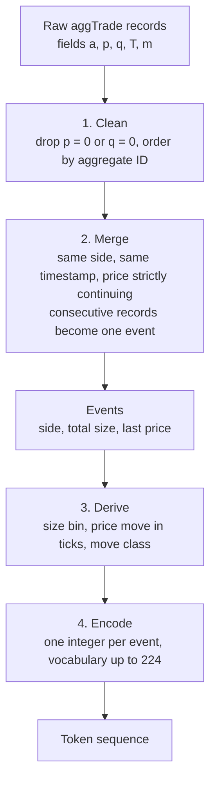

# Tokeniser design

**Status (snapshot 2026-10-09):** fully specified; not yet implemented. All five design decisions are settled. A few implementation details are listed in [section 9](#9-implementation-details-not-yet-pinned-down).

**Context:** this tokeniser feeds the model described in [project-design.md](project-design.md).

---

# Part 1. Overview

## What the tokeniser does

It turns the raw Binance BTCUSDT trade feed into a sequence of integer tokens. **One token describes one taker order** (an "event"). The token says three things:

1. **Side:** did a buyer or a seller take liquidity?
2. **Size:** how many BTC were traded, on a log scale.
3. **Price move:** how far did the price move, in ticks, relative to the previous event?

There are no time fields. The token stream has no clock.

## Pipeline

## The token at a glance

Each token combines three fields.

| Field | Values | Meaning |
|---|---|---|
| Side | 2 | Buy aggressor or sell aggressor |
| Size bin | up to 16 | Log-spaced edges, 3 per decade, rare tails merged |
| Move class | 7 | Flat, up 1 tick, up mid, up large, down 1 tick, down mid, down large |

The vocabulary is at most $2\times16\times7=224$ tokens, with one softmax over all of them.

## Worked example (illustrative numbers)

The previous event ended with a last fill at **82,000.10**. The next five raw records arrive:

| `a` | `p` | `q` (BTC) | `T` | aggressor | note |
|---|---|---|---|---|---|
| 5001 | 82,000.10 | 0.0020 | t1 | buy | starts an event |
| 5002 | 82,000.11 | 0.0150 | t1 | buy | same side, same time, price up: **merge** |
| 5003 | 82,000.13 | 0.0400 | t1 | buy | same side, same time, price up: **merge** |
| 5004 | 82,000.12 | 0.0010 | t2 | sell | different side and time: new event |

Event 1 (records 5001 to 5003):

- **Side:** buy.
- **Size:** $0.0020+0.0150+0.0400=0.0570$ BTC. This lies in $[0.05,\,0.1077)$.
- **Last fill:** 82,000.13. The previous event's last fill was 82,000.10, so the move is **+3 ticks**.
- **Move class:** up, and 3 ticks is 2 or more, so it is "up mid" or "up large" depending on the training median of such moves (about 104 ticks in the sample, so "up mid").

That is one token. Event 2 (record 5004) is a separate sell event.

---

# Part 2. Design notes

## 1. Why one token per event, not per record

Binance's aggTrade record sums fills of the **same taker order at the same price and time**. A taker order that sweeps several price levels is therefore split into several records, one per level. Treating each record as a token would turn one decision into several tokens that are strongly dependent.

So records are merged back into events. In a live sample of 388,987 records, 58.4% of records sit in multi-record events, and the sample collapses to 199,944 events (about 1.95 records per event). Merging is not a marginal clean-up.

## 2. Cleaning

- Drop records with price 0 or quantity 0. Binance flags audit duplicates this way (also with first and last trade ID -1).
- Order by aggregate trade ID (`a`).

## 3. Merge rule (decision 2)

Walk the cleaned records in order. A record joins the current event when all three tests pass:

1. **Same side.** The aggressor is a seller if `m` is true (buyer was maker), and a buyer otherwise.
2. **Same timestamp.** `T` is equal. Recent data files use microseconds.
3. **Price strictly continues in the aggressor direction.** For a buy, the price is higher than the previous record's price. For a sell, it is lower.

Otherwise the record starts a new event.

An event has:

- `side`: the common side.
- `size`: the sum of record quantities, rounded to the lot step of 0.00001 BTC.
- `last_price`: the price of the last record in the event.

**Notes on this rule**

- An earlier idea was to also require contiguous trade IDs. That test was vacuous: in the 388,987-record sample, 100.000% of adjacent record pairs were contiguous. It was dropped.
- Test 3 rarely binds at microsecond resolution. Of 190,101 same-side, same-microsecond pairs in the sample, only 1,058 failed it (1,051 at the same price, 7 against the aggressor's direction). It is kept as a cheap guard. It would bind more often with millisecond timestamps.
- If a future data check showed that merging changes almost nothing, the merge step could be dropped. The sample shows it matters.

## 4. Field 1: side (2 values)

Buy aggressor or sell aggressor, from `m` as above. The side of an event is the side of its records.

## 5. Field 2: size (decision 5, parts 1 and 2)

### Unit

Size is measured in **BTC**, not USDT notional. This is the native unit of the data and of order book depth. Note that both units drift over time, so neither is a stationary measure.

### Bins: log-spaced edges

Size bin edges are fixed constants on a log scale, 3 bins per decade:

$$ e_k = 5\times10^{-5}\cdot 10^{k/3}\ \text{BTC},\qquad k=1,\dots,15. $$

The constant $5\times10^{-5}$ BTC is about the minimum notional (5 USDT at current prices). The 15 edges give up to 16 bins:

| Bin | From (BTC) | To (BTC) | Note |
|---|---|---|---|
| 1 | 0 | 1.08e-4 | includes the smallest lots |
| 2 | 1.08e-4 | 2.32e-4 | |
| 3 | 2.32e-4 | 5.00e-4 | |
| 4 | 5.00e-4 | 1.08e-3 | |
| 5 | 1.08e-3 | 2.32e-3 | contains 0.002 BTC, a very common size |
| 6 | 2.32e-3 | 5.00e-3 | |
| 7 | 5.00e-3 | 1.08e-2 | |
| 8 | 1.08e-2 | 2.32e-2 | |
| 9 | 2.32e-2 | 5.00e-2 | |
| 10 | 5.00e-2 | 0.108 | |
| 11 | 0.108 | 0.232 | |
| 12 | 0.232 | 0.500 | |
| 13 | 0.500 | 1.08 | |
| 14 | 1.08 | 2.32 | |
| 15 | 2.32 | 5.00 | |
| 16 | 5.00 | no upper limit | |

(Edges rounded to three significant figures. Three of them, $5\times10^{-4}$, $5\times10^{-3}$ and $0.05$, fall exactly on a multiple of the lot step. See [section 9](#9-implementation-details-not-yet-pinned-down).)

### Tail rule

Any outermost bin holding **under about 1% of the training events** is merged into its neighbour, so the outermost bins become open-ended. This keeps every token common enough for the model to learn a stable embedding. The final number of size bins is therefore at most 16, and is decided by the training data.

This is the only fitted part of the size field. The edges themselves are fixed.

### Why log-spaced, not quantile bins

- **Fits human perception of magnitude.** The project treats tokenising as "linguifying" the tape. The step from 0.001 to 0.01 BTC reads as the same kind of step as 0.01 to 0.1 BTC.
- **No ties.** Order sizes cluster on round numbers: in the live sample, 0.002 BTC was 9.46% of events. Quantile edges at tied values collapse, which forces an extra rule (merge duplicate edges, or random tie-breaking). Fixed log edges avoid the problem.
- **Fixed edges** do not depend on the training period, so they are easy to explain and reproduce.

### What the log scale costs (from the simulation)

On the live sample, 60/40 train/test, comparing with quantile bins (edges at $k/16$ of training sizes, duplicates merged):

| Measure | Quantile bins | Log bins (3 per decade) |
|---|---|---|
| Bins used | 15 | 16 |
| Entropy of size token | 3.85 bits | 3.49 bits |
| Share of training events in the three largest bins | n/a | 0.25%, 0.08%, 0.03% |
| Rolling-surprisal variability (CV, unigram proxy) | 0.025 | 0.036 |
| Train-to-test drift (total variation distance) | 0.081 | 0.071 |
| Mutual information with a high-volatility flag | 3.11 millibits | 2.35 millibits |

Reading these:

- Log bins are **less evenly occupied**, so entropy is lower.
- The thin top bins are the main weakness. The tail rule is the fix. The comparison was **not rerun with the tail rule applied**.
- Mutual information with the volatility flag is tiny for every scheme and probably within noise. These are unigram proxies, not results about the transformer.
- Log bins drift slightly less from train to test.

The decision was to accept the lower entropy in exchange for interpretability, fixed edges and no tie handling.

## 6. Field 3: price move (decisions 1, 3 and 4)

Three separate questions define this field. Each has its own decision.

| Decision | Question it answers | Answer |
|---|---|---|
| 1 | **Which two prices** are compared? | The last fill of this event, and the last fill of the previous event |
| 3 | **In what unit** is the difference written? | Ticks of 0.01 USDT, as a whole number |
| 4 | **How is the number sorted** into classes? | Flat, plus three magnitude bins in each direction |

### Decision 1: which prices are compared

The move of event $t$ compares the last fill price of event $t$ with the last fill price of event $t-1$:

$$ \Delta P_t = P^{\text{last}}_t - P^{\text{last}}_{t-1}. $$

An event can contain several fills at rising or falling prices. Using the last fill captures the whole impact of the order. Using the previous event's last fill also captures any gap between the two events.

### Decision 3: the unit

$\Delta P_t$ is divided by the tick size, so the move is a whole number of ticks:

$$ \Delta_t = \frac{\Delta P_t}{0.01}. $$

The alternative was basis points (a percentage of price). Ticks were chosen because the tick is the smallest possible price step, so the result is an exact integer and does not need rounding.

Example: the previous event ended at 82,000.10 and this event ended at 82,000.13. Decision 1 says to subtract these two prices, which gives 0.03 USDT. Decision 3 says to write that as 3 ticks.

### Decision 4: the classes

Seven classes: **flat** ($\Delta_t=0$) plus three magnitude bins in each direction ($k=3$).

| Class | Condition |
|---|---|
| flat | $\Delta_t = 0$ |
| up 1 / down 1 | $\lvert\Delta_t\rvert = 1$ tick |
| up mid / down mid | $\lvert\Delta_t\rvert \ge 2$, at or below the training median of such moves |
| up large / down large | $\lvert\Delta_t\rvert \ge 2$, above that median |

The magnitude edges are fit on **absolute moves in the training period** and are shared by up and down moves.

### Why bin 1 is exactly one tick

One tick is a natural unit: it is the smallest nonzero move. In the live sample, 51% of nonzero moves were exactly one tick, and the median of moves of 2 or more ticks was 104 ticks. These numbers come from a single ~5-hour window, so the study-period values will differ.

## 7. Encoding

Let $S$ be the final number of size bins after the tail rule. Number the sides $0..1$, size bins $0..S-1$ and move classes $0..6$. The token ID is

$$ \text{id} = (\text{side}\cdot S + \text{size}) \cdot 7 + \text{move}. $$

The vocabulary is $2\cdot S\cdot 7 \le 224$. The model uses a single softmax over this set. There are no separate heads per field.

## 8. Fitting and leakage rules

- Everything fitted uses the **training period only**: the price-move median and the tail-merge decision.
- The log size edges are constants and are not fitted.
- Test-period events are mapped with the training-period edges and the same tail merges.
- A rare test-period event outside the training range falls into an open-ended outer bin. Nothing is fitted to the test period.

## 9. Implementation details not yet pinned down

These were not discussed explicitly. Pick a sensible choice, record it in the decision log, and keep it fixed.

- **Floating-point edges.** Sizes are whole multiples of 0.00001 BTC. Three log edges land exactly on a multiple of the lot step ($5\times10^{-4}$, $5\times10^{-3}$, $0.05$). Compare in integer lot units, or with a small tolerance, so that a size equal to an edge goes to the same bin every time.
- **Tail rule procedure.** Apply it from the outside in until every outer bin is at or above 1%. Interior bins below 1% are not merged.
- **Median boundary.** Whether a move exactly equal to the median is "mid" or "large" is not fixed.
- **First event.** The first event of the stream has no previous event, so it has no price move and is skipped.
- **Timestamps.** The merge test needs equal timestamps at the data's native resolution. Do not truncate microseconds to milliseconds.

## 10. Decision log

| # | Question | Chosen | Alternatives rejected |
|---|---|---|---|
| Merge | Treat each Binance record as a token, or merge into events? | Merge into events | One token per record |
| 1 | Which two prices define the price move? | Last fill of this event minus last fill of the previous event | Not recorded here; see the project memory |
| 2 | When do consecutive records belong to one event? | Same side, same timestamp, price strictly continuing in the aggressor direction | Trade-ID contiguity (vacuous: 100% contiguous) |
| 3 | What unit is the price move written in? | Ticks (0.01 USDT) | Basis points |
| 4 | How are the moves sorted into classes? | Bin 1 = exactly 1 tick; bins 2 and 3 split moves of 2 or more at the training median; shared edges up and down | Terciles of all nonzero moves |
| 5.1 | What unit is size written in? | BTC | USDT notional |
| 5.2 | How are sizes sorted into bins? | Log-spaced, 3 per decade from $5\times10^{-5}$ BTC, tail bins under about 1% merged | Quantile bins with merged duplicate edges; random tie-breaking |

Other fixed choices: $k=3$ magnitude bins per direction, single composite token, no time fields, edges fit on training only.

## 11. Evidence base

All numbers above come from one live sample, fetched on 2026-10-09 from the Binance market-data mirror (`data-api.binance.vision`):

- 388,987 aggTrade records, about 5.3 hours, price drifting from about 82,648 to 81,054 USDT.
- 199,944 events after merging.
- Not the study period. Use it for design sanity checks, not for results.
